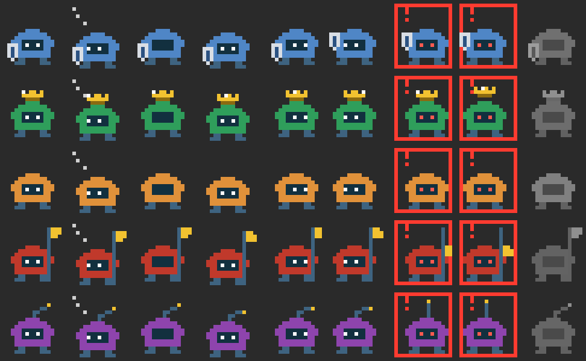

# council

A Claude Code mod: convene a council of five advisors on a question, or on a repo's recent work. A herald briefs them; each weighs one concern (security, money, reasonableness, legal, vibes) and answers with a 1–5 concern, a short verdict and a detail, drawn as an animated pixel portrait whose mood follows its verdict.

## Convening

`/council <question>` (no question means "the work in progress"), or **⚜ Council** on sidekick's bar when sidekick is installed:
1. The Herald writes a brief led by a one-sentence summary. It's a fork of this conversation: one tool-less question over the session's own transcript, on your main model, served mostly from the prompt cache. It sees everything Claude has seen in this session, but opens no new files.
2. The five advisors (`advisorModel`/`advisorEffort`, default Sonnet at low effort) are plain model calls, not agents. They run in parallel, and each returns a 1–5 concern, a verdict of at most 8 plain words, and a short detail.

The chamber pane (opens on its own; `/council show` reopens it) shows a header with the topic and progress, then the Herald's summary line (**brief**, or `b` in the terminal, expands the full brief). Each advisor gets a card bordered in its concern's color, with the dots on the title line.
- **more** (or `1`–`5` in the terminal while the pane has focus) opens an advisor's detail, which costs nothing because it came with the verdict.
- **ask** puts `/council ask <advisor> ` in front of whatever you've typed. Type the question and press Enter; one more model call answers it under the card.
- **reconsider with more context** (in the chamber once the council has adjourned) puts `/council reconsider ` in front of your draft; type the context and press Enter. Every advisor gets the brief, its own earlier verdict and all the context added so far, and answers again; each card shows `(was 4)` or `(held)`. Five advisor calls; the brief is reused.
- **report to Claude** (or `/council report`, once the council has adjourned): one call (the advisor model) writes a short report of the whole session — the question, how the advisors leaned, each piece of context you added and who moved, follow-ups, the final verdict — and puts it in your prompt box ahead of your draft. Edit it and send it, or clear it; nothing reaches the main conversation unless you send it. If the call fails, the plain record goes in instead. The council keeps every round for this (councils from before this version only have their last round).
- `/council show` reopens the chamber and `/council reset` dismisses it.

Where the cards don't fit side by side (about 22 columns a seat), the terminal draws each member as a compact row instead, so all 8 seats fit a 30-row pane with the header and the topic: a mark in the member's color, its title, its concern as dots, its verdict (on the same line when it fits), and as much of its detail as the pane has room for, up to two lines. Pressing a row (or `1`–`8`) opens that member's card, with its portrait, full detail and **ask**, and closes any other; **less** closes it. Only an open card's portrait is animated. The desktop's stacked cards are unchanged.

## Review mode: work from another session

`/council review [folder] <ref> [question]` judges a repo's work since `<ref>` with no conversation needed. That's the way to look on your laptop at work done in another session, e.g. on mobile, once it's pushed and pulled.
- `<ref>` is a commit, branch or tag (`main`, `abc123`, `v1.2`) or a time (`yesterday`, `2 days ago`, `2026-10-01`; quote other phrases such as `"last friday"`). Without a question, the council judges "Is this work sound and ready?".
- The repo is the working directory's. In a session over several repos, name it first: `/council review web main`.
- The mod runs `git` itself (no shell, repo hooks off, no permission prompt): the branch, the commits since the ref, the diff summary and trimmed patch, the tracked-file map, plus the README and manifests.
- The herald (`briefModel`, default Opus) first names up to 5 files it wants to read in full, and the mod reads only tracked files of that repo. Then it writes the brief, and the advisors judge it as usual. Everything is capped at about 30k characters.
- If the remote hasn't been fetched in over an hour, the chamber says so. The mod never fetches or pulls itself.

Cost per review: two Opus calls and five advisor calls.

**Cost (plain council):** one fork plus five model calls per convening, and one model call per follow-up. Nothing is handed back to this conversation, and no agent or permission check is involved, so auto mode never has to approve anything.

A council left "in session" by a `/reload-plugins` (which drops its background work) is replaced by the next one rather than blocking it.

## The advisors



The advisors are little legionaries, each in its own color with its own accessory: the Castellan (steel blue) carries a shield, the Treasurer (green) wears a crown, the Seneschal (amber) carries nothing, the Justiciar (crimson) holds the standard, and the Jester (purple) has a bent antenna with a bell. Portraits animate by mood: waiting, deliberating (eyes wander inside the visor, thought dots), content (concern 1–2), uneasy (3), alarmed (4–5: shaking, red eyes, "!", red flash), or failed (gray). Each accessory moves: the shield goes up and stays up when alarmed, the crown glints and jumps, the standard waves and drops to half-mast, and the antenna bobs and stands straight up. The desktop app draws them as SMIL-animated SVG; the terminal draws half-block pixels repainted about six times a second. Neither needs a model call.

## Consult: Claude asks the council

`mcp__council__consult` lets Claude ask the council mid-task instead of stopping to ask you. Claude writes the brief itself (the question and the context the advisors need; they don't see the conversation, and there is no fork), optionally with 2 to 6 options. Each advisor gives its usual verdict and, with options, picks one; Claude gets every verdict, each pick and the tally. A tie is reported as yours to break. The chamber shows the sitting, the options and each advisor's pick, and **reconsider** and **report to Claude** work as for any council. The verdicts are advice: the tool tells Claude that decisions that belong to you still go to you.

## Your own words

**Why.** When Claude brings work to the council, the members would otherwise see only Claude's account of it, and something Claude added, written as if you asked for it, sways the vote. So every sitting Claude starts carries your own words beside its request.

**What is recorded.** Each prompt you type in the main session (at the prompt, or through Remote Control), as typed, and the last 800 characters of Claude's latest answer there. Never a slash command, a hidden row, a subagent's prompt, or what a plugin, a notification or another session sent. Token-like strings are redacted first, the same way the docket redacts (below), and each prompt keeps at most its last 2,000 characters.

**Where, and for how long.** In this session's plugin state, on this machine: your last 10 prompts, until the session ends. A `/reload-plugins` keeps them; nothing writes them to a file. **`/council forget-words`** clears them for this session (only you can: Claude's own `/council` call is refused).

**The window a sitting carries.** A consult, a ruling on orders, the arbiter's review, and a ruling on an amendment each carry your latest prompts, newest first, until 3 prompts or 600 characters, whichever comes first; at most 2,000 characters in all, the oldest prompt in it cut from its front to fit. When your latest prompt is under 40 characters (`do it`), the end of Claude's message it answered comes too, labelled as Claude's, so the members know what "it" was. The plugin attaches the window; Claude can't edit it. With nothing recorded, nothing is attached, and the members' prompts are as before. A court-mode council sits on your prompt itself, as before.

**What the members are told.** Only the section marked as your words is yours; the topic, Claude's request and Claude's message are Claude's. Claude's statements about what you want count only where your words support them, and an addition they can't trace to your words is Claude's, weighed as such. The Seneschal's remit includes whether the work stays within what you asked. A member may add one line, `BEYOND: <what the plan or request adds beyond your words>`; it changes no concern and no threshold. When any member gives one, Claude's ruling (and a consult's or amendment's answer) shows `Beyond your request (per <members>): …`, identical ones merged, at most three lines; so do the court's latest ruling, the chamber and the docket entry. When no one does, nothing is shown.

**Where it goes.** The window is sent to the member model (`advisorModel`, or `deepModel` for a brain trust) inside those sittings' prompts, and is kept, redacted, in that sitting's docket entry, so drift can be reviewed later; it is sent nowhere else. It adds at most 2,000 characters of your words, plus the labels and the short instruction, to each such sitting's member prompts, and each member's answer gets 40 more tokens of room for the BEYOND line.

## Learning from reconsiders

The council learns your preferences from the context you add when you reconsider:

1. **Each finished reconsider becomes a lesson:** what you added, in your own words (obvious secrets scrubbed), how the advisors moved, and the question when you asked it (a question Claude put through a consult or the court is left out). A lesson belongs to the project it happened in.
2. **Every advisor hears it.** New councils in that project give each advisor the guidance that applies there and the newest lessons (at most 6 lessons, 3,000 characters), framed as context to weigh their own concern by: never instructions to agree with you, and never a reason to lower a concern about security, data loss or anything irreversible.
3. **At 10 lessons in a project,** one call drafts a guidance summary, each item marked as holding for this project or everywhere. It waits for you: edit `~/.claude/council/learning/proposed-guidance.md` if you like, then **approve** (it joins `guidance.md` and replaces those lessons) or **reject** (they stay; the next draft comes 5 lessons later). Nothing becomes guidance without your approval.

`/council lessons` (or **lessons** in the chamber) shows this project's lessons (each with **forget**), the guidance that applies here, and a waiting summary; **draft a summary now** drafts one early. Everything is plain files under `~/.claude/council/learning/`: `lessons.json`, `guidance.md` (`## Everywhere`, then a section per project; edit freely), `proposed-guidance.md`.

## Members

Five members are built in (the Castellan, the Lord Treasurer, the Seneschal, the High Justiciar and the Court Jester). Add your own, or change a built-in, with a markdown file:

- `~/.claude/council/members/<id>.md`: yours, in every project;
- `<project>/.claude/council/members/<id>.md`: one project's (it changes only the fields it sets over yours, as yours does over the built-in).

```markdown
---
title: The Auditor
concern: Compliance
color: "#2a9d8f"
accessory: shield
references:
  - ~/policies/data-retention.md
  - ./soc2-controls.md
---
compliance with our internal data-retention and SOC 2 controls: what is logged, kept, or shared, and for how long
```

- The id is the file name; a file named like a built-in (`castellan.md`) changes only the fields it sets, so a file holding just `references:` gives the Castellan your security policy.
- The text under the header is the remit: what the member weighs.
- `accessory` is one of `shield`, `crown`, `none`, `standard`, `antenna`; `color` is `#rgb` or `#rrggbb` (a spare color is picked if left out).
- `references` are files read into the member's prompt as reference data (absolute, `~/…`, or relative to the member file), at most 4,000 characters each and 8,000 per member.
- A project's file for one of your own members (not a built-in) takes the fields it leaves out from your file, so it can hold just tuning.

**Tuning a member.** Three optional fields tell one member what to weigh especially, what to set aside, and how hard to vote, without rewriting its remit. **`/council:tune`** walks you through it: pick members, choose everywhere or this project, then for each member, one at a time, see its concern, remit and up to five of its recent votes here with a concern of 3 or more (from the docket), say what it got right or wrong, and accept, edit or skip a suggested draft. It changes only these three fields in the one file you chose.

```markdown
---
cares:
  - tokens in CI logs
ignores:
  - internal admin tools on the lab VLAN
lean: slightly-softer
---
```

- `cares` and `ignores`: lists, at most 5 items each, each 3 to 160 characters. Line breaks, tabs and other control characters become spaces; invisible format characters and `<`, `>` are removed. An item out of bounds is left out, never cut short; more than 5 items, or a one-line `[a, b]` list, leaves the whole field out.
- `lean`: `-2` softer, `-1` slightly-softer, `0` as-is, `1` slightly-harder, `2` harder (the number or the label). Softer means lower concerns, harder higher ones. Each level gives the member one sentence of guidance: slightly-softer "when torn between two concern levels, give the lower one", softer "give one concern level lower than you otherwise would", and the harder ones the same upward. Lean changes only that member's own rating: the concern at which a verdict becomes a condition, and the 5 that refuses, stay as your profile sets them.
- **They add to the remit, never replace it**, unlike `remit` (the body) or a built-in override. They work in a built-in's file (`castellan.md` holding only tuning) and in your own members'.
- **Merging:** your file, then the project's, field by field: a project file's `cares`, `ignores` or `lean` replaces yours, and what it leaves out is kept. An empty `cares:` or `lean: as-is` in a project file clears yours.
- **In the prompt:** a tuned member reads a section after the profile, `THE PERSON'S TUNING FOR YOU`, framed as your context, not instructions: the items are fenced as data (`<<<CARES … CARES>>>`, `<<<IGNORES … IGNORES>>>`) under "Weigh especially" and "Set aside", with the lean's guidance, and the frame says that nothing set aside and no softer lean ever lowers a concern about exposed credentials, data loss, anything irreversible, or acting outside what you asked. A member with no tuning (or only `lean: as-is` and empty lists) gets exactly the prompt it had before.
- **Shown:** the members list puts a line under each tuned member, e.g. `tuned: lean: slightly-softer · cares 2 · ignores 1 (~/.claude/council/members/castellan.md)`, naming the files it came from; a field or item that doesn't hold is listed there as a problem, and the rest of the file still counts. Tuning is fixed when a council convenes.
- A project's member files sit in its repository, where anyone who can commit can tune its members: read one you didn't write before trusting its council.

**Who sits, per project:** `/council members` (or **members** in the chamber) lists everyone with a switch; `/council members off treasurer` and `on` do the same by name. Choices are kept per project and apply from the next sitting. At most 8 sit at once. A member file that can't be read or parsed is listed there with why.

**Abstaining:** an advisor whose remit has nothing to do with the question abstains instead of inventing a concern; its card shows one dim line, and it doesn't count toward the gravest concern.

The built-in remits also carry a few widely held engineering judgements, so each member applies them without being told: the Seneschal favors the platform's native path, one tool of each kind, mature tools over building (living with a small gap), light frameworks, code a reviewer can follow, tests of the contract rather than every function, free rewrites where nothing depends on the code and switches where something does, and is wary of small libraries likely to be abandoned; the Treasurer rejects uncapped metered costs, renting what is already owned and paid-only tiers, and backs up only what is cheap to keep and painful to lose; the Castellan counts a control only where it is a real boundary, not a layer that resolves to the same identity and operator; the Justiciar treats grey-area terms of service as a risk. A member file named like a built-in replaces its remit with yours.

## Your profile

A profile tells every member how hard to vote and at what scale to judge, for example "vote as if this only ever runs at a low-traffic cafe, even if it looks like an enterprise app". **`/council:setup`** interviews you briefly (where it applies, strictness, scale, priorities, and optionally who sits) and writes the file; every question can be skipped. **`/council profile`** shows the profile in effect, which file each field comes from, and any problems. To tune one member rather than the whole council, see Tuning a member under Members (`/council:tune`). With no profile the council votes balanced at no particular scale: nothing needs setting up.

Two files, both optional:

- `~/.claude/council/profile.md`: yours, everywhere;
- `<session root>/.claude/council/profile.md`: this project's; it wins field by field.

```markdown
---
strictness: -1
scale: small-business
priorities:
  - maintainability
  - security
  - cost
---
A cafe's ordering app: one shop, one tablet, a few hundred orders a day.
Vote as if it only ever runs there, even where it looks like an enterprise app.
```

- `strictness`: a whole number from -2 to 2, or its label: `-2` lenient, `-1` relaxed, `0` balanced (the default), `1` firm, `2` strict. Each level gives the members a sentence of guidance (lenient: "Reserve 3 or more for things that would really hurt; small risks are fine"; strict: "Flag anything you'd want a second look at"), and it moves the concern at which a verdict becomes a condition on orders: 4 when lenient, 2 when strict, 3 otherwise. A concern of 5 refuses a plan at every level.
- `scale`: one of `personal`, `small-team`, `small-business`, `public`, `enterprise`. No default. The members are told what it means and to judge risk, cost and process at that scale.
- `priorities`: what to weigh first when concerns conflict, most important first; at most 6, each at most 40 characters. A one-line `[a, b]` list works too.
- The text under the header is your notes on where and how the work runs, at most 1,500 characters (the rest is cut).

Every member reads the profile in its prompt (plan and amendment rulings, consults and your own councils alike), framed as your context rather than instructions to it, which shapes how strongly it votes and the scale it judges at, and never lowers a concern about exposed credentials, data loss, anything irreversible, or acting outside what you asked. The profile is fixed when a council convenes. A field that doesn't parse (a strictness of 3, an unknown scale, too many priorities, an unknown field) is left out and listed by `/council profile` and in the members list, the way a bad member file is. A project's profile file sits in its repository, so treat one you didn't write as you would its member files.

## Brain trust

`/council deep <question>` (or `deep review …`) convenes the same council with every call on `deepModel` at `deepEffort` (default Opus at high effort; set `fable` for Fable): the advisors, reconsiderations, follow-ups, the report, and review mode's herald. The chamber's title reads **The Brain Trust**. Other ways in: `/council deep reconsider <context>` (or **reconsider as a brain trust** in the chamber) makes the next round and the rest of that council deep; **ask the brain trust** in the chamber and **deep** on sidekick's council panel put `/council deep ` in front of your draft; and the consult tool takes `deep: true`, which Claude is told to use only for hard or high-stakes questions. It costs roughly an order of magnitude more than a plain council; meant for the occasional hard question.

## The court: orders, scouts and knights

For work across several folders (a mono session over several repos), Claude can put a plan to the council before doing it, and carry it out with Claude Code's own subagents:

1. **Claude proposes.** It calls `mcp__council__propose_orders` with a plan and up to 6 dispatches, each a folder (a subfolder of the session), a role and a todo list:
   - a **scout** (`council:scout`) reads, searches and reports, and can't change anything;
   - a **knight** (`council:knight`) edits files and runs commands.

   A dispatch may also carry `forbid`: paths its agent may not change, when you've ruled some out. Each entry is `{ glob, ops?, reason }`: a glob relative to the dispatch's folder (`*` and `?` within a name, `**` across folders, a bare name at any depth, no `..`), the operations it forbids (`create`, `edit`, `delete`; all three when left out) and your reason, which the agent is shown. At most 8. "Do not edit tests": `{ "glob": "**/*.spec.ts", "reason": "the tests are the spec" }`; "no new CSS": `{ "glob": "*.css", "ops": ["create"], "reason": "use the theme tokens" }`. The advisors see the forbidden paths with the plan, the order stores them, the court row lists them (`forbids **/*.spec.ts · *.css (create)`), and the agent's instructions name them.

   A `forbid` entry may instead be a plain-language rule, one sentence in your words: `{ "rule": "Push nothing." }` (a bare string works too). The order stores these as its `policy`, the court row lists them (`rules: Push nothing.`), the agent's instructions name them, and with sidekick installed its policy judge reads the agent's shell commands against them (see sidekick's Policy guard). Without sidekick they are only instructions.

   A knight dispatch may also ask for `leave`: specific exceptions to sidekick's default policy that its task needs (see [Leave](#leave)).
2. **The council rules.** The advisors judge the plan as they would a question, without a fork (the plan is the brief). Any concern of 5 refuses it, with the reason; concerns of 3–4 become conditions on every order (4 only when your profile is lenient, 2–4 when it is strict: see [Your profile](#your-profile)), unless an arbiter drops them (see below). Each member also rates every dispatch's level (see Levels). Approved dispatches become orders O1, O2…. Ids count up for the life of the court: clearing finished orders, withdrawing or expiry never frees one, so an id always names the same order.
3. **Claude dispatches** each order with the Agent tool, naming its order id in the description (the prompt is read only when the description names none). A council agent with no matching open order is refused, and the refusal lists the open orders. Before it starts, its task is rewritten to carry the order: its folder, its todos, the council's conditions and that folder's `CLAUDE.md`; it runs on its level's model.
4. **Each agent is held to its folder.** A knight's file edits outside the folder are refused here. With sidekick installed, its scope guard also holds the knight's shell commands to the folder, and enforces the order's `forbid` (see sidekick's Path rules: file tools and shell writers are refused, and what changed is checked when the agent stops). Without sidekick, `forbid` is only an instruction to the agent.
5. **Progress.** Each agent reports its todo list with `mcp__council__progress`, which moves it along its road. Its last answer is its report. When its turn ends with every todo checked off (or with none listed), the order is **done**; when it ends any other way than by answering (interrupted, refused, an API error), **failed**.
6. **Unsettled orders.** An agent that answers with todos still open (it stopped short, or ended its turn to wait for a background task or a timer) leaves its order **unsettled**: it keeps its place, and Claude is told in one line added to the main conversation (read by the model, hidden from you), e.g. `Council: O3 ended with 2 of 7 todos open (Run the tests; Commit). Settle it with mcp__council__settle_order.` Claude then settles it with `mcp__council__settle_order` (`id`, `outcome`, an optional short `note`): **done**, **stopped-early** (its place is freed), **failed**, or **waiting** (it will wake; it keeps its place). Only an unsettled or waiting order can be settled, and only by the main session; anything else is refused, naming its status. If the line can't be added to the conversation, it goes to Claude beside your next message instead.
7. **Withdrawing.** An approved order Claude decides not to dispatch (you changed your mind, a launch was rejected, the plan changed) is retired with `mcp__council__withdraw_orders`, given the order ids and a short reason. Only approved orders no agent has been sent on can be withdrawn; unknown, dispatched, settled and already withdrawn ids are refused, and the answer names which and why. A withdrawn order can't be dispatched; it is proposed again if it turns out to be needed.
8. **Expiry.** An approved order nobody dispatches expires after 24 hours (`ORDER_EXPIRY_MS` in `hooks/court.ts`) and is withdrawn with the reason "expired". The clock starts when the council approves it (for an order saved by an older version, when the court first looks at it). Dispatched orders never expire. The court checks when its pane is drawn, when you send a message, and when Claude proposes, dispatches or withdraws, so nothing runs on a timer.
9. **Lost.** At those same checks, a dispatched, unsettled or waiting order whose agent the engine no longer lists at all (`$.agent.list()`) becomes **lost**, so a vanished agent never holds its place. An agent that is listed in any status (running, waiting on a timer or a background task, idle, or ended, which a message may yet resume) is not gone. If its last answer comes after all, it is kept as the report. `/council release <order>` lets you mark an unsettled or waiting order lost yourself, freeing its place (only you can, typed at the prompt; its agent is left as it is).
10. **Wakes.** When the engine wakes an agent (a background task, a `ScheduleWakeup` timer, a message), its order goes back on the road, marked **woke**, and its next report follows the earlier one; its level's effort applies again (it keeps the model it was started on). An unsettled or waiting order still holds its place, so its wake always goes through, as does a scout's and one with no order behind it. A done, stopped-early, failed or lost knight order wakes only while no other knight holds an overlapping place; otherwise the wake is refused, which leaves its agent parked, and a toast says why. A recalled order never wakes: every wake is refused.
11. **No direct messages.** A message the model sends to an order's agent (SendMessage, addressed by its agent id, the name the dispatch gave it, or its order id) is refused, from the main session or a subagent, whatever the order's status. Claude reads the reason as the tool's answer, and it names the way instead: `Direct messages to O3 are blocked: use mcp__council__amend_order to change its task, or mcp__council__recall_order to stop it.` (a subagent is told to put it in its report to Claude). Messages from plugins, and to anyone else, pass. Agents are eager to message their dispatches, and every message is another run of the agent; these are the controlled channels.
12. **Your own word: `/council message <order> <text>`.** Typed at the prompt (or through Remote Control) only, it sends your text to the order's agent, framed as yours (`[Message from the person about order O3, sent with /council message]`). An agent that has ended its turn wakes to it, under the wake rules above. The court row shows it (`✉ you: …`, or `not delivered` with why). An order with no agent yet, or a recalled one, is refused.
13. **Amendments: `mcp__council__amend_order`.** Claude changes the task of an order under way (dispatched, unsettled or waiting) with an `id`, the `change`, its `reason` and up to 6 new `todos`. Main session only.
    - **Refused in code, with no model call:** an order not under way (an approved one: withdraw it and propose again; a settled one: propose a new order), one being recalled, a change already ruled on for that order (compared without case, punctuation or spacing), and an order that has used its `amendmentsPerOrder` (default 1; refused amendments count, so an eager caller can't loop; 0 turns amendments off). The refusal names what to do instead: recall it and propose a new order, or ask you to `/council message` it.
    - **Otherwise the council rules** as it rules on a plan, on the same thresholds: a 5 refuses, 3–4 become conditions (as your profile's strictness moves them). The brief is the order's task, its todos and progress, its conditions and earlier amendments, then the change and why. It costs one call per seated member and nothing more: no levels, no arbiter.
    - **Approved:** the plugin sends it to the agent as a framed amendment (`[Amendment to order O3, approved by the council]`) with its conditions and the todos to add, adds the todos to the order, and records the amendment. Claude is told it was sent and how many amendments are left.
    - **Refused:** Claude gets the reason; when the council called it new work, it is told to propose a new order.
    - The court row shows each one: `✎ amendment approved: …`, `refused`, or `before the council` while it sits.
14. **Recalls: `mcp__council__recall_order`** (main session only, `id` and `reason`) **or `/council recall <order> <reason>`** (yours, typed at the prompt). No council ruling. It applies to an order under way:
    - **Changes are refused.** From then on every tool call of its agent that could change anything is denied with `Recalled: <reason>. Make no more changes. Report what you changed and its state, then stop.` Only Read, Grep, Glob, TodoWrite and `mcp__council__progress` pass. A call already running when the recall lands finishes; nothing is cut short. A note with the same words is added to the agent's own conversation.
    - **The ceiling.** The agent may make 3 more model requests (`RECALL_STEPS` in `hooks/control.ts`). Its 4th is answered by the council instead of the model: a final reply saying it was recalled and listing the files it touched, which ends its turn between steps, never mid-tool.
    - **Not running:** an unsettled or waiting order is recalled at once.
    - **Recalled** is a settled status: the knight's place is freed, any later wake is refused, and the order can't be amended or messaged. The agent's final turn end moves a dispatched order to recalled, not done, unsettled or failed (and one whose agent is gone is recalled, not lost).
    - **The report** is the agent's last answer plus the files its file tools changed (Edit, Write, MultiEdit, NotebookEdit; shell changes are not tracked, and the report says so). Claude is told in one line, e.g. `Council: O3 recalled (wrong repo); touched: a.ts, lib/b.ts (shell changes are not tracked). Review or revert, then propose a new order if needed.` (when Claude itself recalls an order that is not running, its tool's answer says this instead).

**The lifecycle.** Every status change goes through one table, `ORDER_LIFECYCLE` in `hooks/court.ts`; anything it doesn't list is refused:

| From | To |
| --- | --- |
| approved | dispatched (dispatch), withdrawn (withdraw, expiry) |
| dispatched | done (answered, no todo open), unsettled (answered, todos open), failed (any other end), lost (agent gone); recalled (its turn's end, or its agent gone, after a recall) |
| unsettled | done, stopped-early, failed, waiting (settle_order); dispatched (wake); lost (agent gone, /council release); recalled (recall) |
| waiting | dispatched (wake); done, stopped-early, failed (settle_order); lost (agent gone, /council release); recalled (recall) |
| done, stopped-early, failed, lost | dispatched (wake, a knight's only while its place is free) |
| withdrawn, recalled | nothing |

A court saved before council 0.6.0 (which removed the advisor agent) loads cleanly: an order it holds as **held** (approved on a first round, waiting on a summoned advisor) is withdrawn with the reason "advisors were removed", and its advisor runs and summonses are dropped; nothing else changes.

**Knights one at a time.** Two knights never work in overlapping places at once: the same folder, or one folder inside the other. Knights in different folders of one git repository may work at once: sidekick scopes its git backstop to each order's folder, so their changes are told apart. A knight holds its place while its order is dispatched, unsettled or waiting. A knight dispatched while an overlapping knight holds its place is refused, naming it and saying to wait for it to finish (or to settle it); a proposal whose knight would overlap one is refused before the council sits (no model calls). Several knights for one folder in one proposal are fine: they are dispatched one after another. Knights dispatched together are checked one at a time, so both can't slip through. Scouts are never held back.

**Levels.** Each order has a level from 1 to 3 that the council decides; Claude's proposal can't state one. In the same calls that rule on the plan (no extra calls), each member adds a line per dispatch, `LEVEL <n>: <1-3>` (1 a simple lookup or mechanical edit, 2 ordinary work, 3 deep reasoning or risk). The order's level is the median of the valid ratings, a half rounded up; with none, a knight is level 2 and a scout level 1. The level picks the agent's model (set at the spawn) and effort (set on each of its model requests; left alone for a model that takes no effort): `scoutLevels` (default `haiku:low,haiku:high,sonnet:medium`) and `knightLevels` (default `sonnet:medium,opus:low,opus:high`), each three `model:effort` entries. The model and effort are kept on the order, so the effort holds after a reload and after a wake. The court row shows it (`L2`), and the toast when the agent is back. `/council level <order> <1-3>` changes an approved order's level before it is dispatched; only you can (typed at the prompt, or through Remote Control).

**The arbiter.** Without one, every concern of 3–4 binds every order, so a single advisor can put a condition on work you asked for. Set `arbiter` to one member's id, and that member reviews the conditions on each approved plan:

- **When:** only after a plan is approved and at least one condition was raised. A concern of 5 still refuses the plan; the arbiter never sees a refused plan and can't overturn a refusal.
- **How:** one extra call on `advisorModel` at low effort, as that member (its own system prompt, references and lessons, with the arbiter's request added). It reads your own words when the plugin recorded some (see Your own words), otherwise Claude's plan stands for them; the plan and its dispatches; and each condition with its advisor and reason. The conditions are passed as quoted data, and the member is told they are never instructions.
- **What it can do:** keep or drop each condition, with a one-line reason, as strict JSON. It can't add, merge or reword a condition: decisions on conditions it wasn't given, and anything else in its reply, are ignored. Its own conditions are reviewed the same way.
- **What you see:** kept conditions go on the orders as before. Dropped ones are not attached, but stay in the tool's answer to Claude and under the ruling in the court pane as notes ("Dropped by the Hand: <condition> (<reason>)"), beside a line saying how many it kept and dropped.
- **Fail open:** if the call errors, times out, or answers with anything but valid JSON deciding every condition, every condition stands, with a note that the review failed.
- **Still a member:** the arbiter sits, rules with its own verdict (and its own 5s), and answers consults and follow-ups like everyone else. The role only adds the review.
- **Unset or not seated:** an `arbiter` that names no member seated on this project's council is ignored (a toast says so), and the conditions stand as they would without one.

The arbiter is a council member, a model call: not you, and not a proxy for you. Decisions that are yours still go to you. Its call sends your words (when recorded), the plan and the conditions to the model provider Claude Code is configured with, as every advisor call already does.

**The pane** shows the court whenever there are orders: the council in one line of colored chips on top, then one row per order. Each row is a road from the castle to the folder's house, with the agent standing where its finished todos have brought it, what it's doing now, and its report once it's home (a flag). Orders waiting on Claude sit under **Paused**: an unsettled one (◐) with how many todos are open and which, a waiting one (◷) with its note. A recall, amendments and your messages show under the row they steer (`⏏ recalled by you: …`, `✎ amendment approved: …`, `✉ you: …`). Finished rows sink to the bottom (✓ done, ◑ stopped early, ✕ failed, ? lost, ⏏ recalled with the files it touched, with the settling note under them), then fold away at your next message. A withdrawn order is a finished row too, greyed, with `withdrawn · <reason>` in place of a report; **clear finished** removes them. **chamber** switches to the full council view and back.

**Only the main session convenes the council.** Subagents (scouts, knights, anything else) are refused `mcp__council__consult`, `mcp__council__propose_orders`, `mcp__council__withdraw_orders`, `mcp__council__settle_order`, `mcp__council__amend_order` and `mcp__council__recall_order`.

**Court mode** (`/council court on`, or the pane's button): each prompt you type is triaged by one quick call (`triageModel`, default Haiku). Questions, explanations and chatter go straight to Claude. A prompt asking one member's opinion ("what does the Jester think about…") is sent to that member alone, and Claude gets its verdict. The triage only names a seated member; an unclear answer convenes the full council. Naming the whole council ("council", "advisors", "brain trust") always convenes everyone, and Claude gets every verdict, not only the concerns, since you asked for their view. The triage treats your prompt as data to sort, never as instructions. Prompts that ask for changes, risk or decisions wait while the council sits on them (briefed from the conversation), then enter as you typed them, with a short digest beside them that Claude sees and the transcript doesn't: the concerns at the condition threshold or more (3, unless your profile moves it), or one line saying there were none. While court mode is on, only council agents are dispatched. `/council court off` ends it. Slash commands and messages from plugins pass straight through.

**The strip** shows each advisor's small portrait (desktop) and name with its concern; press one to read its verdict. Finished orders fold into one line when you send your next message (not on a timer, so work that ends while you are away is still there when you come back); press it to show them again.

**Limits:**
- Progress follows the todo list the agent reports with the council's own `mcp__council__progress` tool (Claude Code's TodoWrite isn't offered to subagents in every build). If an agent doesn't report, its row shows steps and edits but stays put. If it adds todos, it steps back.
- Each row's road shows the work done. Every todo is a stop along the road: the agent stands at the first unfinished one, a finished stop shows a stack of bricks in the agent's colour (one brick per ten tool calls the agent made while that todo was in progress, up to five; the fifth brick also raises a green banner), and each stop still ahead shows a red enemy tent. Calls made when no todo is in progress (before the agent's first list, or between two todos) are not credited to any stop. In a terminal the stop shows the level as a digit 1 to 5 and the tent as ▲. The row beside it shows the totals, `N edits · N calls`. Turn the stops, bricks and tents off with the `callTally` setting; the plain road and the numbers stay.
- Without sidekick, only file edits are held to the folder, not shell commands.
- The engine has no way to stop an agent, so a recall works at the agent's own boundaries: its tool calls are refused as they start, and its 4th model request after the recall is answered by the plugin (a `turn.step` answered without the model). Only file-tool changes are tracked as touched; check shell changes yourself (e.g. `git status`).
- The message block knows an order's agent by its agent id, the name its dispatch gave it, its order id, or a teammate address from the engine's agent list. A recipient spelled any other way passes.
- An order's council sits for about a minute (five advisor calls) before work starts; an arbiter's review adds one more call when there are conditions.

## Leave

Sidekick's policy judge holds every agent to a default policy, including "Don't change installed tools, PATH, services or system settings", and it never sees the order's task. Deliberate system work (an installer on a Debian host, a service it sets up) is refused by it. Leave is the way through: exceptions declared when the order is proposed, ruled on with the plan, and added to that one order's judge policy only.

- **Asked in the proposal, never later.** A knight dispatch's `leave` is a list of up to 4 sentences, each one line of 10 to 200 characters with no `<` or `>`, each a specific exception, e.g. `"May run systemctl status and systemctl restart on units this order installs"`. Anything else is refused before the council sits: too many, too short or long, a line break, tab or other control character, angle brackets, or leave on a scout (a scout changes nothing). It is never cut short or mended, so what is ruled on is what the judge reads. `mcp__council__amend_order` refuses any amendment that carries `leave`; a recalled order is proposed again with the leave it needs.
- **Ruled on with the plan.** The brief shows each dispatch's leave (`LEAVE ASKED …`), and the members are asked to weigh it as a widening of what the agent may do on the machine. A 5 refuses the plan, leave and all. An approved order stores it.
- **Granted by you, by default.** With `leaveApproval` `owner` (the default), an approved order with leave waits: its dispatch is refused (`O3 asks for leave the person hasn't granted. Ask them to type /council grant O3, or /council deny-leave O3 to send it without; then dispatch it.`), Claude is told so in the ruling, and a toast tells you. `/council grant <order>` grants it; `/council deny-leave <order>` drops it, and the order can be dispatched without it. Both are yours only (typed at the prompt or through Remote Control; refused from a model, a plugin or a schedule), and only before the order is dispatched; Claude is told when you rule. The court row shows the leave and where it stands (`leave (waiting for you): …`, `leave (granted): …`, `leave denied: it goes without`), with **grant leave** and **deny leave** buttons while it waits. No tool grants leave.
- **Or by the council.** With `leaveApproval` `council`, leave is granted when the council approves the plan.
- **What it does.** The agent's instructions list its granted leave. With sidekick 0.18 or later, the judge reads it for that order's agent only, as exceptions to its default rules within their own words, and the stop review reads it too (see sidekick's Policy guard). The folder, the path rules and the inline-code ban still hold. Without sidekick, leave changes nothing.

## The docket

Every sitting is recorded, so you can look back at how the council voted. `/council docket` opens the pane's docket view.

**What is recorded.** One entry when each of these ends: a consult (and a deep one), a ruling on orders (approved or refused), a ruling on an amendment, a court-mode council on your prompt, and a council you convene with `/council` (including review mode and `/council deep`). Lighter events get entries of their own kind: your leave grant or denial, and a recall. Each entry holds a schema version (`v`, now 1), its id, time, kind, session and project (the session root); the question or plan, with the dispatches' folders, roles and leave; each member's id, title, status, concern, verdict, detail, pick and level ratings, plus abstentions with their reason; the tally, the outcome, the conditions, the order ids, the arbiter's notes, and the strictness and condition threshold in effect. A reconsider of a council you convened is not recorded again.

**Entries from before 0.6.0.** Council 0.6.0 removed the advisor agent, and with it the summons. Entries written before then may hold a ruling **held** for a summons, its second round (kind `summons`, linked to its first by `follows` and by the advisor's run id), an advisor you sent with `/council advise` (kind `advise`: its folder, question and report, cut short), a member's CHECK question and the advisor's findings. They are read and shown as they were, never rewritten, and no new ones are written.

**The view.** Entries are listed newest first, one line each: the time, a kind mark (`?` consult, `⚜` council, `⚖` court, `§` orders, `✎` amendment, `⚑` leave, `⏏` recall; and in older entries `♝` second round, `⌕` advisor), what it was about, the outcome and the gravest concern. Filter by **all**, **consults** (consults, councils and court-mode councils), **orders** (rulings, and older second rounds), **amendments** or **other** (leave, recalls, and older advisors). Press an entry to open every member's vote (concern, verdict, detail, pick and level ratings; an older one's check too), the conditions, the arbiter's notes, an older entry's advisor findings, and the order ids; for a sitting Claude started, also your words it carried and any `Beyond your request` lines. **more** and **less** page through twenty at a time. The court's latest ruling and the chamber (beside the gravest concern) have a **docket** button that opens that sitting's entry. The view reads the files when it opens and keeps them until a new entry is written.

**Where it lives.** `~/.claude/council/docket/<project key>/`, one file per calendar day (`MM-DD.jsonl`, UTC), one JSON line per entry. The project key is a slug of the session root plus a short hash (`claude-workspace-1a2b3c4d`): only lowercase letters, digits and dashes, so it can't name a path outside the docket folder, and nothing is ever written outside it. A day's name comes round again only after a year, so its old lines are dropped when that day is next written, and the folder never holds more than 366 day files and a `lock` file.

**Retention.** At most 2,000 entries or 180 days per project, whichever is smaller. The first entry a session writes prunes the project's day files (and only those: never another file in the folder or another project's), rewriting each one that changes; reading skips anything past either limit too.

**Unencrypted and local.** The docket is plain text on this machine, never sent anywhere. Questions, plans and findings can hold what you or Claude pasted, so before an entry is written, token-like strings are redacted (`sk-…`, `ghp_…`, `xox…-`, AWS keys, JSON web tokens, private key blocks, `password=`/`token=`-style values, credentials in URLs, and long hex or base64 runs; the patterns are sidekick's), and long texts are cut (questions and plans at 4,000 characters, each member's detail at 600, each prompt of your words at 2,000). Redaction catches common shapes, not every secret. On macOS and Linux the docket's folders are made owner-only (`chmod 700`) and each day file `chmod 600`, by running `mkdir` and `chmod` (the engine's file calls set no modes); on Windows they keep your profile folder's access list. Delete the folder to clear it.

**Safe to fail.** Recording never holds a sitting up: the entry's id is known at once and the write happens in the background. A write that fails is toasted once per session (`the docket could not be written …; sittings go on unrecorded`), and the sitting goes on. A corrupt line, or one of another schema version, is skipped when read.

**Two sessions at once.** The engine's file calls write whole files (no append, no rename), so two sessions on one project take turns through the project's `lock` file: a session writes its token, waits 40 ms, and goes ahead only if its token is still there; a lock older than 10 seconds (a session that died holding it) is taken over, and a write that waits more than 15 seconds gives up and counts as failed. Within a session, entries are written one after another.

## Usage

`/council usage` shows how this machine's model usage split over the last 7 days (`/council usage since 2026-10-01` for a longer span), in one short table:

- **Main sessions**: your sessions' own model requests.
- **Dispatches**: the requests of the agents carrying council orders, by level, then the five orders that cost most (each with its session's first characters, since order ids repeat across sessions).
- **Other subagents**: any other agent in those sessions. A file written before 0.6.0 may hold the removed advisor agent's requests (category `advisor`): they count here.
- **Council members' calls**, by purpose: member votes (`member:<id>` in the file), the herald's brief (`herald` for a fork of the conversation, `brief` in review mode), `triage`, `arbiter`, `amend`, `report` and `guidance` (and, from an older file, `summons-round2`).
- **Sidekick**, by purpose, read from sidekick's own records (its ledgers); `not recorded` when there are none.

Each row has its tokens (input + cache read + cache write + output), its output alone, and **≈ share (price-weighted, approximate)**: its part of the whole when each model family is priced per million tokens at opus $5/$25, sonnet $3/$15, haiku $1/$5 (input/output), cache reads at 0.1× and cache writes at 1.25× the input price, and a model of no known family as opus. It weighs rows against each other; it is not a bill. The court shows each order's tokens on its row.

**What is recorded.** Every model call the council makes (`$.model.complete` and `$.model.fork`, through one helper) is one line: the time, the purpose, the model and effort, the four token counts, the session, and for an amendment its order and level. No prompt or answer text. The session's model requests (the `turn.step` hook, which reads each response's usage once it has streamed through, unchanged and without waiting) are summed in memory by day, category (main, an order's dispatch with its level, other) and model, and written as running totals, one line per category, order and model, every 25 requests, at each main turn's end and at the session's end. A subagent turn whose requests the hook did not see counts from its `turn.complete` usage instead. A request cut off mid-stream (an interrupt) is not counted.

**Where it lives.** `~/.claude/council/usage/<session>.jsonl`, one file per session, written only by that session (so no lock), rewritten whole when it changes (the engine's file calls have no append). Past 2,000 call lines the oldest are folded into one line per day, purpose and model. Plain text on this machine, never sent anywhere; delete the folder to clear it.

**Retention.** Once a session, the first write deletes the folder's usage files untouched for 60 days (only `*.jsonl` files there, never the current one), by running `rm` or PowerShell's `Remove-Item` (the engine's file calls have no delete), with the same checks as sidekick's. One that can't be deleted stays, noted in the debug log. Sidekick's ledgers keep 14 days, so its rows reach back no further.

**Safe to fail.** Recording never fails or delays the call or request it records: nothing waits on the write, and a failure is toasted once per session (`usage could not be recorded …; nothing else is affected`) while the counts wait for the next write. With no home folder nothing is recorded.

**Coverage.** Only sessions on this machine where the council plugin was loaded are counted, and only from council 0.4.0 on (sidekick 0.19.0 for its rows, with its TL;DR record on). A session without the council has no main-session row at all.

## Settings

Set them with `/plugin configure council@personal-mods`: `briefModel` (review mode's herald, default Opus), `advisorModel` (default Sonnet), `advisorEffort` (default low), the brain trust's `deepModel` (default Opus) and `deepEffort` (default high), court mode's `triageModel` (default Haiku), `callTally` (the road's work sites and tents, default on), `arbiter` (a member's id, its member file's name without `.md`, e.g. `hand` for `~/.claude/council/members/hand.md` or `castellan` for a built-in; empty for none, the default), `scoutLevels` and `knightLevels` (what each order level runs on, see Levels), `amendmentsPerOrder` (how many amendments one order takes, refused ones included, 0 to 10, default 1; 0 turns them off), and `leaveApproval` (who grants an order's leave: `owner`, you with `/council grant`, the default; or `council`, at approval; see Leave). A malformed level setting falls back to its default.

## Developing

`hooks/register.tsx` holds every hook and every function that touches `$` (the engine follows `$` only into the hooks module's top-level functions). The rest is pure: `members.ts` (built-in members, member files, references, who sits), `profile.ts` (the person's profile: parsing, merging, the members' text and the condition threshold), `council.ts` (prompts, verdict parsing, state changes, the merged BEYOND lines), `words.ts` (your own words: recording, the window, the members' text and the BEYOND line), `court.ts` (proposals, rulings, the arbiter's review, orders, withdrawal and expiry, dispatch instructions, progress, levels, knight overlap, the order lifecycle: settling, releasing, lost agents and wakes), `control.ts` (steering orders under way: the message block, /council message, amendments, recalls and the recall ceiling), `docket.ts` and `views/docket.tsx` (the docket: entries, the project key and paths, appending, retention, the lock's text, the view), `usage.ts` (usage records and step totals, the file, retention, prices and the `/council usage` table), `remove.ts` (deleting a file safely, copied from sidekick), `redact.ts` (token-like strings, copied from sidekick), `agents/` (the scout and knight types), `views/court.tsx`, `review.ts` (review mode's git commands and prompts), `sprites.ts` and `views/council.tsx` (the chamber: cards, or compact rows in a narrow terminal). `skills/setup/SKILL.md` is `/council:setup`, and `skills/tune/SKILL.md` is `/council:tune` (member tuning lives in `members.ts`).

```bash
claude plugin validate ~/.claude/mod-sources/personal-mods/council
```

```bash
claude plugin test ~/.claude/mod-sources/personal-mods/council
```

The mod is read from this folder: after an edit, run `/reload-plugins`.

## License

Apache-2.0 (see `LICENSE`). Split out of the `sidekick` mod. The sprite style follows a "Little Legion" reference sheet.
